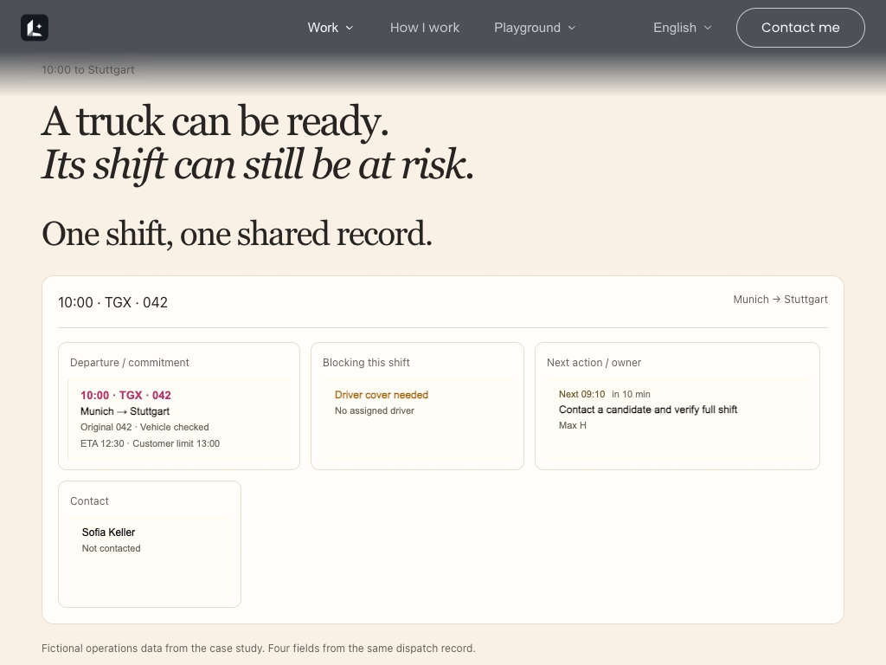
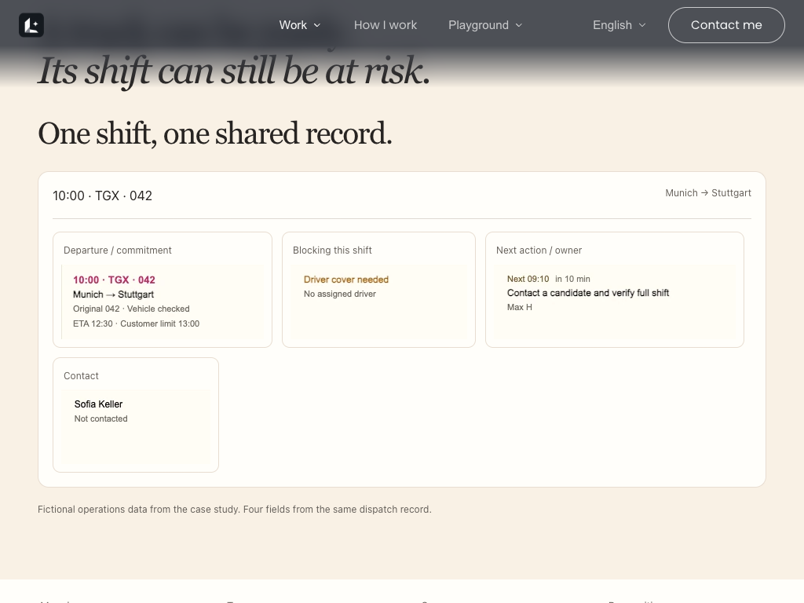

# PR 69: reversible static-origin preference toggles

B at 1024×768 could jump back 100px after a static → animated → static round trip. The production baseline reproduces scrollY **660 → 1078 → 560**. The correction returns **660 → 1078 → 660**. Before/after static screenshots of the corrected round trip are byte-identical.

The component records the static reading position when enabling motion and restores it only if the reader has not scrolled and the viewport, section position and both layout heights still match. Moving away and back or resizing away and back invalidates the stored return point. A/B share this correction; CSS, card geometry, native scroll mapping and timing are unchanged.

The new source is commit `f627d0ff1681888e39a5c335ca1b582d064dab06`. `TESTED_SOURCES.json` records hashes matched to the isolated production routes. `MAN_REDUCED_A.patch` and `MAN_REDUCED_B.patch` apply on the matching revision-2 variants and reproduce these same bytes. The earlier PR 69 patch must be replaced, not applied twice.

Both variants built together using `pnpm build` and `next start --port 4848`. Four routes expose the corrected A/B and original 43929ae A/B for comparison. Port 3000 was untouched. The shared test lock serializes installed Google Chrome runs. The QA scripts are preserved with a `MAN_ROUTE` override for these comparison routes.

- B 1024×768: all 14 preference round trips passed, scrollY and following-content return drift 0px; no console/page errors. Full data: `B_1024x768/toggle.json`.
- A 1024×768 and 1440×900: 28 preference round trips passed, return drift 0px; no console/page errors. Data: `A_1024x768/toggle.json`, `A_1440x900/toggle.json`.
- Four additional scenarios passed: repeated no-scroll toggles, scroll before returning, scroll away and back, viewport resize away and back. Data: `EXTRA.json`.
- Full-tree typecheck still fails with the same 10 diagnostics as QA's prior baseline; output is byte-identical. `TSC.log` contains the diagnostics. The inherited preview config skips type errors during production build, so the successful build does not imply a passing typecheck.
- Full `pnpm install --frozen-lockfile` passed. No package test script exists. No Rive build.

The static-to-animated intermediate view can still land at progress 0.8436 in B 1024: the static stage is taller than the sticky stage. This repair follows the assigned option of restoring the original static reading position when no scrolling occurred. It does not change the intermediate animation mapping.

Current follow-up does not test Safari, physical devices, 390px preference toggles or bfcache. QA's previous bfcache observations are historical, not a claim for this revision. A/B selection, independent QA recheck and production integration remain pending.

## B 1024 data

| Position | Before y | Motion/static toggle y | Back y | Return drift |
|---|---:|---:|---:|---:|
| sticky25 | 714 | 560 | 714 | 0 |
| sticky50 | 867 | 560 | 867 | 0 |
| sticky85 | 1082 | 560 | 1082 | 0 |
| released45 | 1520 | 1102 | 1520 | 0 |
| sectionAbove | 1856 | 1438 | 1856 | 0 |
| deepNext | 2716 | 2298 | 2716 | 0 |
| static_top0 | 560 | 560 | 560 | 0 |
| static_in100 | 660 | 1078 | 660 | 0 |
| static_in300 | 860 | 1278 | 860 | 0 |
| static_in600 | 1160 | 1578 | 1160 | 0 |
| static_below | 1458 | 1876 | 1458 | 0 |
| static_resized | 760 | 1178 | 760 | 0 |
| anchor | 675 | 560 | 675 | 0 |
| pagedown | 1456 | 1038 | 1456 | 0 |

## A normal-motion regression

All compared fields in `combo_scroll_1440x900.json`, `combo_scroll_1440x1000.json` and `combo_scroll_1024x768.json` match the original A route. Comparison includes scroll range, section geometry, final/released positions, overlap and direction checks; variable wheel sample counts are excluded. The complete `scene_probe.json` is identical across corrected/original A: eight viewport geometries and keyframes, blocked/loaded font cases, and live/fresh resize comparisons. See `regA/`, `regBEFORE_A/` and `SUMMARY.json`.

Test lock start: `[test-lock] 开始 08:21:06 负载 6.15 9.96 12.23 排队 0 秒`.
Test lock end: `[test-lock] 结束 08:30:16 负载 5.39 5.61 8.80 退出码 0`.

Initial setup failures are retained locally in `OUTBOX/MAN_R69_ROUNDTRIP_20261105_249a/`: external symlinks rejected by Turbopack, existing CSS selectors rejected by webpack, a stopped broad-root attempt, transient build-lock contention, and ENOSPC. The passing production build used self-contained dependencies/assets after disk space recovered. These setup failures are not application regression failures and were not counted as passing checks.

Before (original B, after round trip):

After (corrected B, after round trip; byte-identical to its starting screenshot):

The scene probe deliberately aborts font requests and records seven `net::ERR_FAILED` console entries in each version; those entries are retained and identical. The zero-error result above applies to preference-toggle and extra invalidation cases, not the font-blocking probe.
